# CEC function indicators can be exported as Excel with one-click statistics, including optimal value, average, standard deviation, worst value, median, rank sum test, box plot.

CEC2005/2017/2019/2021/2022 Function Set Intelligent Optimization Algorithm Comparative Experiment Common Indicators One-Click Export to Excel, All in One!
Previously, we released a guide on how to automatically count the intelligent algorithm indicators for the CEC2005 function set. However, many users have inquired about how to call other function sets. Today, we bring you a comprehensive guide on exporting common indicators for the intelligent optimization algorithms of the CEC2005/2017/2019/2021/2022 function sets to Excel with one click.
Common indicators include: mean, standard deviation, optimal value, worst value, median. Additionally, box plots and rank sum tests are included.
Many users also asked about the purpose of box plots and rank sum tests.
Here is a brief introduction.
Rank sum test is generally used to compare the differences between improved intelligent algorithms and other algorithms by comparing the optimal value arrays obtained from multiple experiments of the improved algorithms with those obtained from multiple experiments of other algorithms. The smaller the value obtained, the greater the difference between the two algorithms. This rank sum test is not necessary; some literature may include it, while others do not. Choose based on your needs!
Let's briefly look at the indicator comparisons in other papers, including rank sum test and box plots:
In some journal papers, you often see a very large table that counts various indicators such as the mean, standard deviation, optimal value, worst value, and median for each algorithm. For example:
Some papers compare the differences between improved algorithms and comparative algorithms by conducting rank sum tests. For example:
Other papers may use box plots to present results more intuitively, for example:
However, if you repeatedly run code to manually count these values, even superheroes would probably not do it this way!
Next up!
Today, we will use MATLAB tools to teach everyone how to directly complete the statistics and export an Excel table, while also drawing box plots.
The algorithm replacement is very simple; just replace the algorithm name!
The current issue will use the Adaptive Spiral Flight Search Algorithm (ASFSSA) as an example, along with other optimization algorithms such as the Dung Beetle Optimization Algorithm, Sparrow Optimization Algorithm, Particle Swarm Optimization Algorithm, and Grey Wolf Optimization Algorithm for comparison.

Each algorithm will be run 30 times, and the optimal value, average, standard deviation, median, worst value, and five indicators such as rank sum test results will be calculated in one click. Box plots will also be drawn.

CEC2005 Function:
Five indicators statistical results:
Rank sum test results:
Box plot:
CEC2017 Function:
Five indicators statistical results:
Rank sum test results:
Box plot:
Note: In the official CEC2017 function, the F2 function has been removed, so now there are only 29 functions.
CEC2019 Function:
Five indicators statistical results:
Rank sum test statistics results:
Box plot:
CEC2021 Function:
Five indicators statistical results:
Rank sum test results:
Box plot:
CEC2022 Function:
Five indicators statistical results:
Rank sum test results:
Box plot:
Code directory:
For this example, we will focus on the CEC2022 function set. The code directories for other function sets follow the same format.

Two scripts can be run, namely plotCEC2022_Main.m and runsCEC2022_Main.m.

The plotCEC2022_Main.m is the usual program to draw the comparative graph of the algorithms, which remains unchanged. For example, it might look something like this:

The key point is that the runsCEC2022_Main.m script, after running, can generate two Excel files: ranksumresult.xls and result.xls. The ranksumresult.xls contains the results of the rank sum test, while result.xls contains the statistical results for the five indicators.
In addition, there is a code in the program runsCEC2022_Main.m that allows for the selection of whether to draw box plots. If not needed, you can set the box_pp variable to 0.
Partial code display:
clear\nclc\nclose all\naddpath(genpath(pwd));\npop_size=30;   %Population number\nmax_iter=500;   % Iteration count\n​\nrun = 30;\nbox_pp = 1;  % Optional 1, or other. When equal to 1, draw a box plot, otherwise do not draw.\nRESULT=[];   % Calculate the standard deviation, mean, optimal value, etc.\nrank_sum_RESULT=[];  % Calculate the rank sum test results\n​\nF = [1 2 3 4 5 6 7 8 9 10 11 12 ];\nvariables_no = 10; % Optional: 2, 10, 20\ndisp(['The one being counted is',num2str(variables_no),'Output the English term only:CEC2022Function set'])\nif box_pp ==1\n    figure('Name', 'Box plot', 'Color', 'w','Position', [50 50 1400 700])\nend\n​\nfor func_num = 1:length(F)    \n    % Display the comprehensive results\n    disp(['F',num2str(F(func_num)),'Function calculation results: '])\n    [lower_bound,upper_bound,variables_no,fhd]=Get_Functions_cec2022(['F',num2str(F(func_num))]);\n    resu = [];  % Calculate the standard deviation, mean, optimal value, etc.\n    rank_sum_resu = [];   % Calculate the rank sum test results\n    box_plot = [];  % Statistical box plot results\n    ……\nend\n%% Write the rank sum test result into elcex\nB = string();\nfor i = 1:length(F)\n    str = string(['F',num2str(F(i))]);\n    B(i,1)= str;\nend\nB = cellstr (B);\nB = [B,num2cell(rank_sum_RESULT)];\ntitle = {" ","DBO","PSO","GWO","SSA"};% The rank sum test is compared with an improved algorithm, so there is no improved algorithm here.\nB = [title;B];\nxlswrite('ranksumresult.xls', B)\n​\n%% Write the results of standard deviation, mean, optimal value, etc. into elcex.\nA = string();\nA = cellstr (A);\nA = [A,num2cell(RESULT)];\ntitle = {" "," ","ASFSSA","DBO","PSO","GWO","SSA"};\nA = [title;A];\nxlswrite('result.xls', A)\n  
Code acquisition:  
CEC2005 indicator statistics link:  
CEC2017 indicator statistics link:  
CEC2019 indicator statistics link:  
CEC2021 indicator statistics link:  
CEC2022 indicator statistics link:

## Images

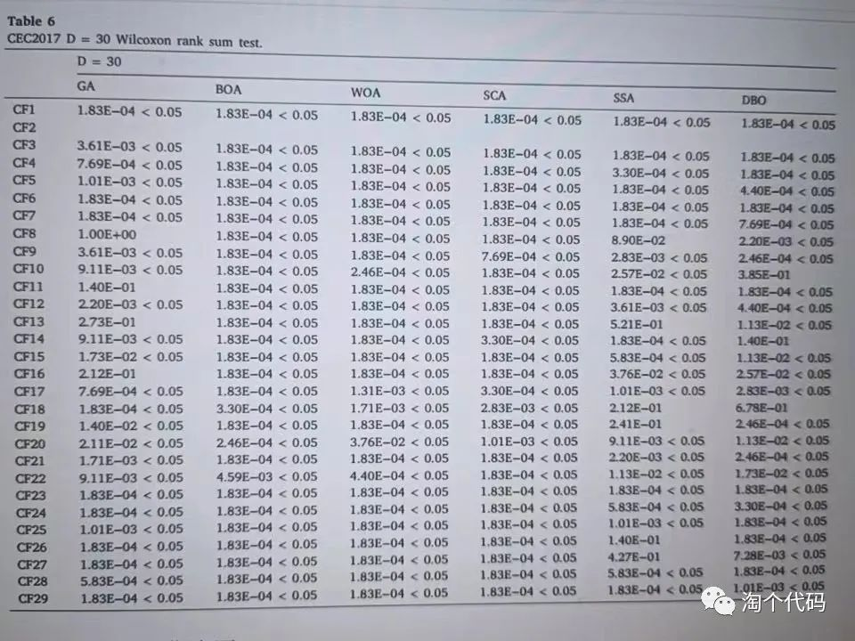

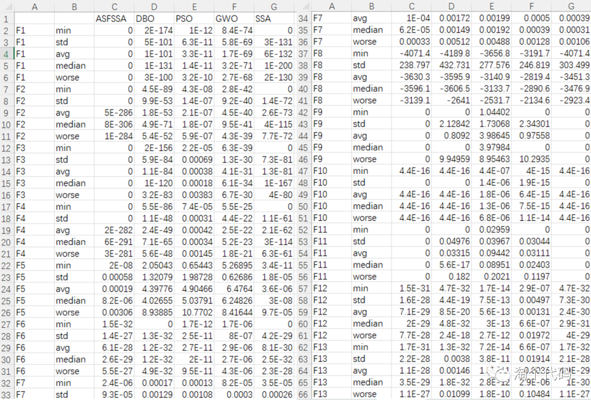
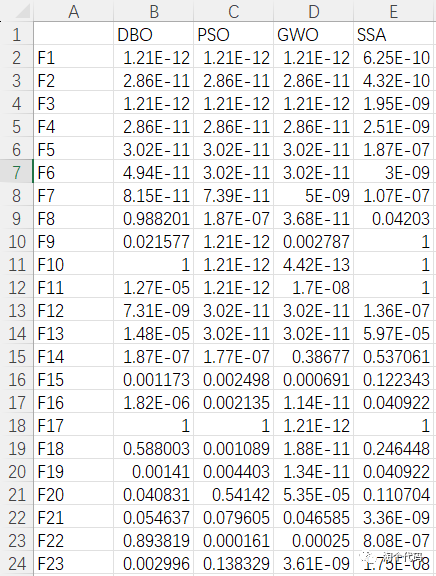
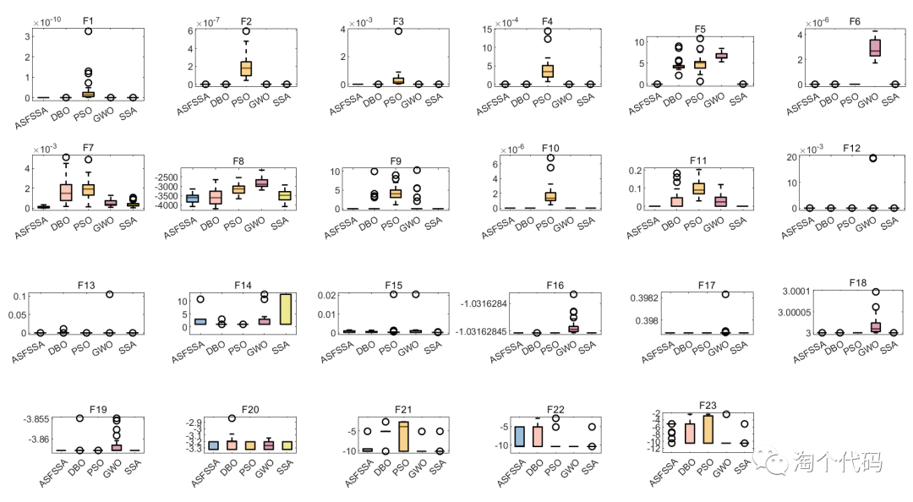
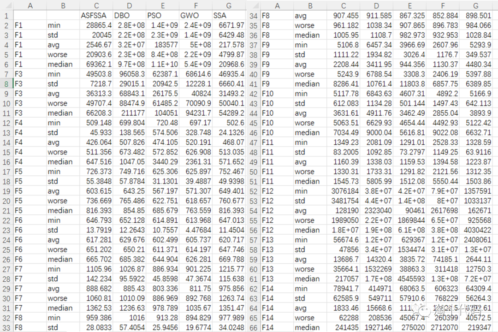
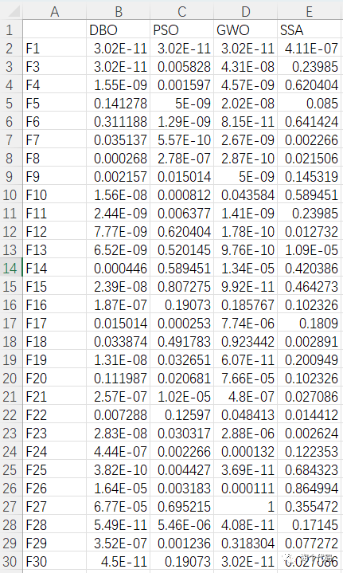
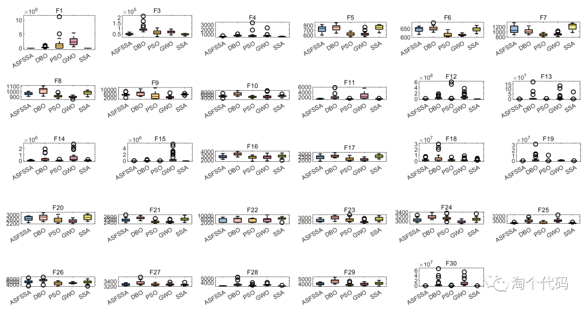
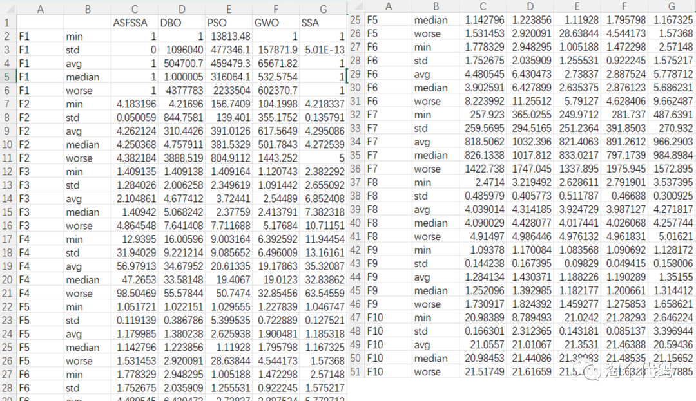
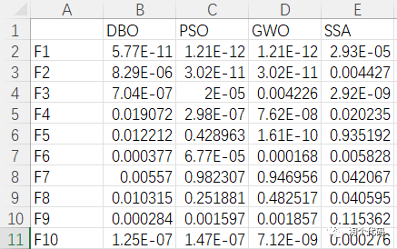
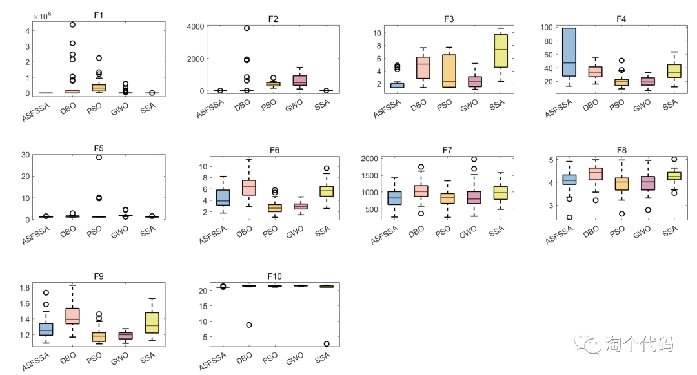
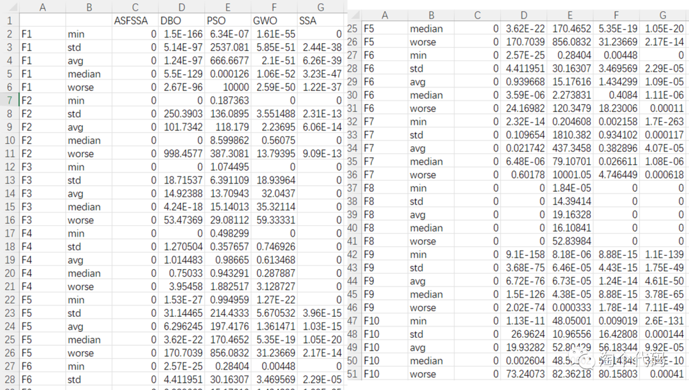
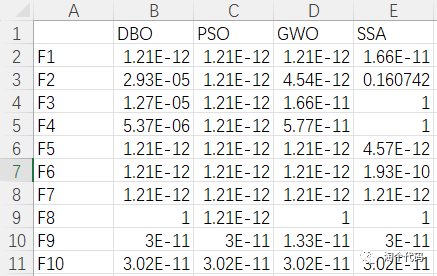
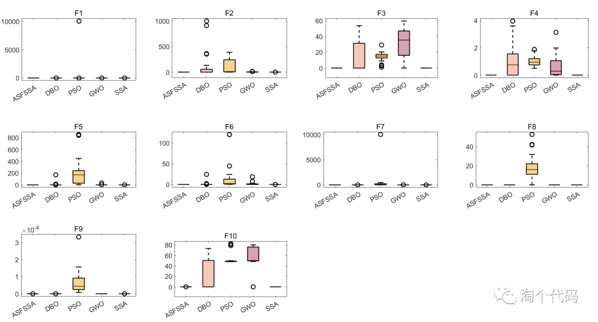
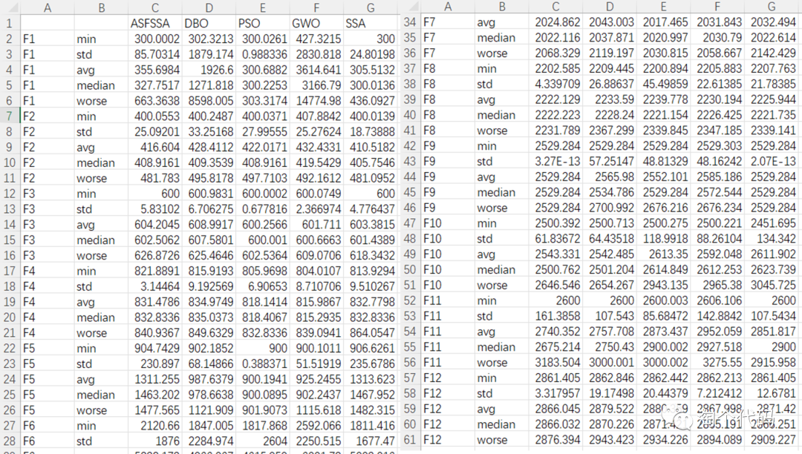
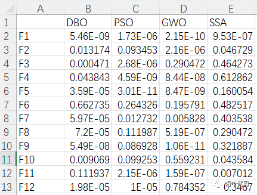
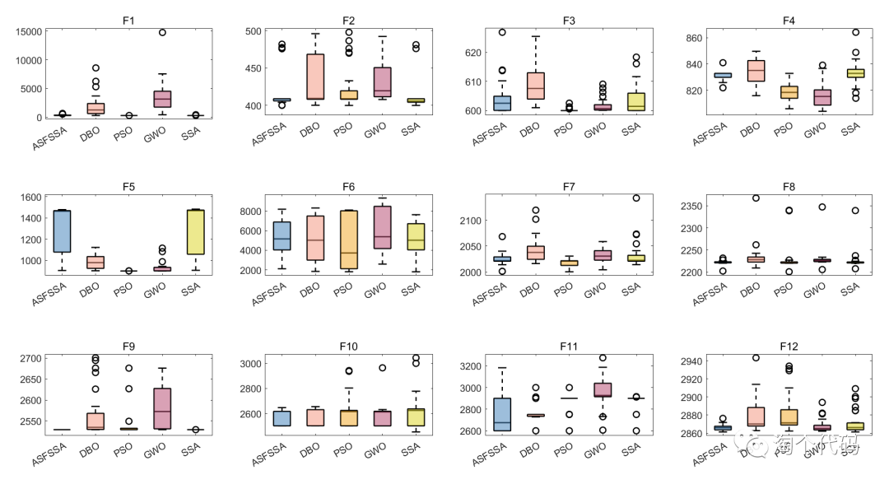
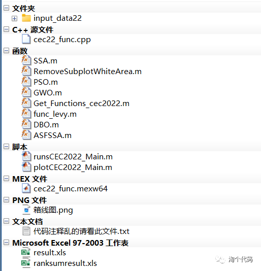
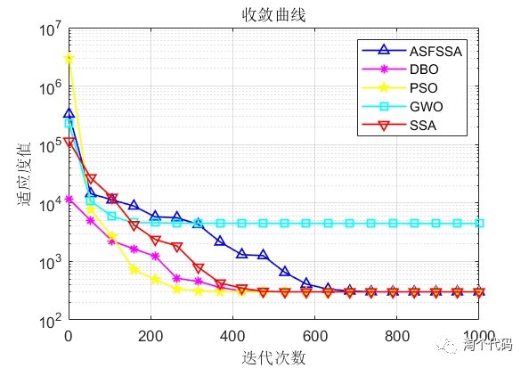

<!-- PAYMENT_BLOCK -->

## Get this dataset

- Payment link (Stripe): [Buy now](https://buy.stripe.com/3cs8yP7sY87d0vu9AB)
- Payment QR code: 

<!-- /PAYMENT_BLOCK -->
